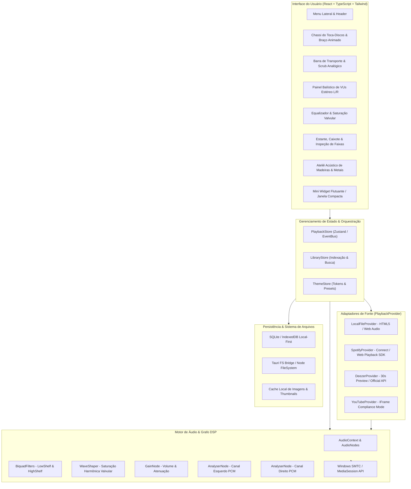
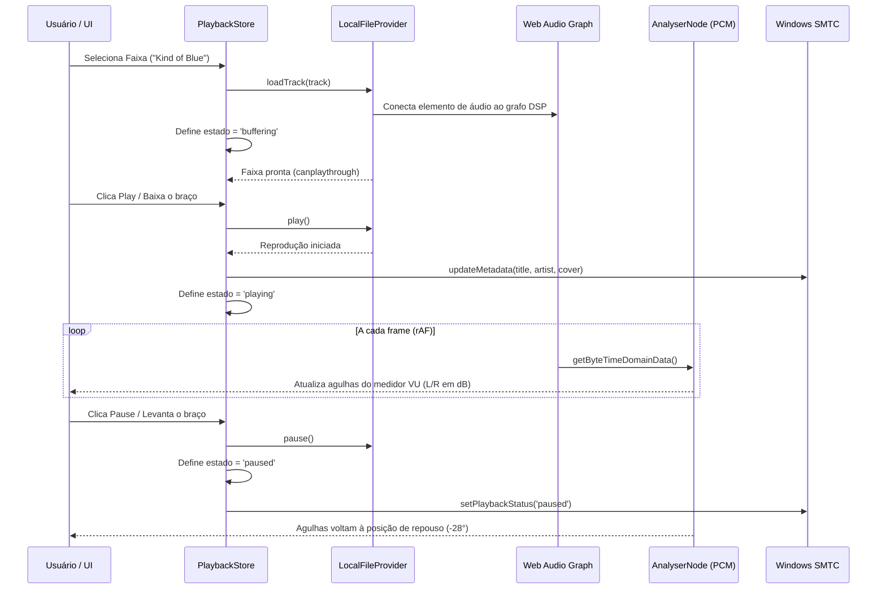

# 02 — Arquitetura de Software do Vitrola Hi-Fi

**Data:** 24 de setembro de 2026  
**Responsável:** Agente 02 (Arquiteto de Software)  
**Versão do Documento:** 1.0 — Local-First Desktop Architecture  
**Documentos Precedentes:** `docs/01-analise.md`, `docs/handoff/01.md`, `referencias/stitch/`

---

## 1. Visão Geral e Princípios Arquiteturais

O **Vitrola** é um reprodutor de áudio para Windows projetado sob o paradigma **Local-First**, unindo a experiência estética e cerimonial de um toca-discos analógico dos anos 1970 com a estabilidade de processamento de áudio moderno.

### Princípios Norteadores:
1. **Autonomia Local Estrita:** O produto funciona plenamente, sem rede, com arquivos locais (FLAC, MP3, WAV, OGG, M4A). Serviços externos são tratados como adaptadores opcionais desacoplados.
2. **Separação Rígida de Camadas:**
   - **Camada de Apresentação (View/Stitch UI):** Reage ao estado sem conhecer detalhes de drivers ou I/O.
   - **Camada de Estado e Orquestração (Player Core & Library Store):** Gerencia fila, metadados, persistência e ciclo de vida.
   - **Camada de Provedores de Áudio (`PlaybackProvider`):** Abstrai a origem sonora expondo uma matriz explícita de capacidades (`ProviderCapabilities`).
   - **Camada de Processamento de Sinal (DSP / Web Audio Graph):** Medição PCM real para VUs, filtros de tom e controle de ganho.
3. **Honestidade de Recursos:** Nenhum recurso é simulado como funcional se não houver sinal real. Se um medidor VU não tiver dados PCM do stream, ele permanece em repouso. Controles indisponíveis em determinado provedor ficam desabilitados com justificativa visível.

---

## 2. Diagrama de Módulos do Sistema



---

## 3. Interfaces de Domínio e Contratos TypeScript

### 3.1. Entidades de Domínio (`Track`, `Album`, `Playlist`)

```typescript
export type AudioSourceType = 'local' | 'spotify' | 'deezer' | 'youtube';

export interface AudioFormatInfo {
  codec: 'FLAC' | 'MP3' | 'WAV' | 'OGG' | 'AAC' | 'ALAC';
  sampleRate: number;      // ex: 44100, 96000, 192000
  bitDepth?: number;       // ex: 16, 24
  bitrateKbps?: number;    // ex: 320, 1411
  channels: 1 | 2;         // Mono / Stereo
  isLossless: boolean;
}

export interface Track {
  id: string;                      // Identificador único (UUID ou hash do caminho)
  source: AudioSourceType;
  title: string;
  artist: string;
  album: string;
  albumArtist?: string;
  year?: number;
  genre?: string[];
  trackNumber?: number;
  discNumber?: number;
  durationSec: number;
  uri: string;                     // Caminho local (file:// ou tauri://) ou URI de streaming
  coverUri?: string;               // URI local da imagem em cache ou URL externa
  format: AudioFormatInfo;
  addedAt: string;                 // ISO 8601
  lastPlayedAt?: string;           // ISO 8601
  playCount: number;
  dynamicRangeScore?: number;      // DR Score analítico (ex: 14 dB)
  labelInfo?: {
    catalogNumber?: string;
    recordLabel?: string;          // ex: "Columbia Stereo 6-Eye", "Odeon"
    matrixRpm: 33 | 45;
  };
}

export interface Album {
  id: string;
  title: string;
  artist: string;
  year?: number;
  coverUri?: string;
  trackCount: number;
  totalDurationSec: number;
  tracks: Track[];
  isHiRes: boolean;
  source: AudioSourceType;
}

export interface Playlist {
  id: string;
  name: string;
  description?: string;
  createdAt: string;
  updatedAt: string;
  trackIds: string[];
  coverUri?: string;
  isSmart: boolean;                // ex: "Tocadas Recentemente", "Favoritas"
}
```

### 3.2. Contrato de Capacidades do Provedor (`ProviderCapabilities`)

Cada fonte declara formalmente o que suporta para que a interface nunca exiba controles falsos:

```typescript
export interface ProviderCapabilities {
  canSeek: boolean;                // Suporte a salto arbitrário no tempo
  canAdjustSpeedPitch: boolean;    // Suporte a alternância 33/45 RPM e fader de pitch
  canReadPCM: boolean;             // Fornece stream de dados brutos para alimentar o VU meter real
  canExtractCoverArt: boolean;     // Permite ler imagem de alta resolução
  canRepeat: boolean;
  canShuffle: boolean;
  hasTrackDuration: boolean;       // Conhece a duração exata antecipadamente
  isOfflineCapable: boolean;       // Funciona sem conexão com a internet
  isFullTrackAvailable: boolean;   // Toca a música inteira (false se preview de 30s)
  restrictionsNotice?: string;     // Mensagem explicativa em caso de limitação
}
```

### 3.3. Contrato de Reprodução (`PlaybackProvider`)

```typescript
export type PlayerPlaybackState = 'empty' | 'playing' | 'paused' | 'buffering' | 'ended' | 'error';

export interface PlaybackStateEvent {
  state: PlayerPlaybackState;
  currentTrack: Track | null;
  currentTimeSec: number;
  durationSec: number;
  volume: number;                  // 0.0 a 1.0
  muted: boolean;
  playbackSpeed: number;           // 1.0 (33 RPM) ou 1.363 (45 RPM)
  pitchRatio: number;              // ±8% fader
  source: AudioSourceType;
  error?: string;
}

export interface PlaybackProvider {
  readonly id: AudioSourceType;
  readonly name: string;
  readonly capabilities: ProviderCapabilities;

  initialize(): Promise<void>;
  loadTrack(track: Track): Promise<void>;
  play(): Promise<void>;
  pause(): Promise<void>;
  seek(positionSec: number): Promise<void>;
  setVolume(volume: number): void;
  setSpeedPitch(rpm: 33 | 45, pitchRatio: number): void;
  stop(): Promise<void>;
  getAudioNode?(): AudioNode | null; // Se integrado ao Web Audio Graph
  destroy(): Promise<void>;
}
```

### 3.4. Fluxo de Eventos do Player



---

## 4. Fronteira Nativa (Tauri / Rust & Fallback IPC)

### 4.1. Comandos Tauri / Rust
A camada nativa em Rust é responsável pelo que a sandbox do navegador não pode fazer com máxima eficiência:
1. `scan_directory(path: String, recursive: bool) -> Vec<RawFileMetadata>`: Varredura de alta performance do sistema de arquivos Windows em thread secundária.
2. `read_audio_tags(file_path: String) -> ParsedAudioTags`: Extração nativa de tags ID3, Vorbis Comments e FLAC metadata sem carregar o arquivo inteiro na memória do JS.
3. `extract_cover_art(file_path: String, output_dir: String) -> Option<String>`: Extração de bytes de imagem embutida e gravação em cache `.vitrola/covers/`.
4. `open_audio_stream_url(file_path: String) -> String`: Criação de rota de streaming local segura (`asset://` ou servidor local HTTP loopback de streaming).
5. `window_toggle_mini_widget(show: bool)`: Controle da janela secundária flutuante de widget.
6. `window_set_always_on_top(always_on_top: bool)`: Fixação no topo.

### 4.2. Isolamento e Segurança de Permissões
- O frontend opera sob permissões mínimas no Tauri (`capabilities/default.json`).
- Acesso ao sistema de arquivos restrito a pastas explicitamente selecionadas pelo usuário via diálogo nativo (`tauri-plugin-dialog`).
- Armazenamento seguro de tokens OAuth: utiliza o Windows Credential Manager nativo via keyring / plugin seguro do Tauri, nunca armazenando refresh tokens em texto plano no `localStorage`.

---

## 5. Persistência de Dados e Migração

### 5.1. Mecanismo de Armazenamento
- **Banco de Dados Local:** SQLite (via `tauri-plugin-sql` ou base local IndexedDB ultra-rápida com Dexie/sql.js como fallback robusto).
- **Tabelas do Banco de Dados:**
  - `tracks`: Metadados completos, hash SHA256 do arquivo, timestamp de modificação, caminho absoluto, metadados de vinil.
  - `albums`: Agrupamento automático de discos com referência de capa e ano.
  - `playlists`: Listas de reprodução do usuário.
  - `playlist_tracks`: Relacionamento ordenado n-para-n.
  - `library_folders`: Diretórios monitorados pelo usuário (ex: `C:\Users\...\Music`).
  - `user_settings`: Configurações de tema, hardware customizado, calibragem e preferências do mini widget.

### 5.2. Migração de Esquema
O banco de dados contém uma tabela de controle de versão:
```sql
CREATE TABLE IF NOT EXISTS schema_migrations (
  version INTEGER PRIMARY KEY,
  applied_at TEXT NOT NULL
);
```
Toda alteração de estrutura é versionada sequencialmente (`001_initial_schema.sql`, `002_add_dr_score.sql`).

---

## 6. Diretórios Monitorados, Cache de Capas e Arquivos Movidos

### 6.1. Detecção de Mudanças e Resiliência
1. **Monitoramento:** Em segundo plano, o sistema observa eventos do sistema de arquivos nos diretórios configurados.
2. **Tratamento de Arquivo Movido / Renomeado:**
   - Ao indexar, calcula-se uma impressão digital rápida baseada no tamanho do arquivo + primeiros 4KB do cabeçalho de áudio.
   - Se um arquivo mudar de caminho, a biblioteca reatribui o registro existente mantendo contagem de reprodução, data de adição e inclusões em playlists, em vez de duplicá-lo como nova faixa.
3. **Cache de Capas:**
   - Imagens embutidas são extraídas para `AppData/Roaming/Vitrola/cache/covers/[hash].jpg`.
   - Se não houver capa embutida, o indexador busca `cover.jpg`, `folder.jpg`, `front.jpg` na pasta do álbum.
   - Se não houver imagem local, gera-se um selo de vinil com cores determinísticas derivadas do nome do artista e do álbum.

---

## 7. Estratégia de Processamento de Sinal e Medição Real de PCM (VU Meter)

O protótipo exibia agulhas balísticas com rotação aleatória via JavaScript. No produto real, implementa-se **medição de PCM legítima**:

```
[Audio Element / Stream] 
       │
       ▼
[MediaElementAudioSourceNode]
       │
       ├──────────────────────────────────────────────┐
       ▼                                              ▼
[ChannelSplitterNode] (Separa L e R)            [BiquadFilter (Bass)]
       │                      │                       │
       ▼                      ▼                       ▼
[AnalyserNode L]       [AnalyserNode R]         [BiquadFilter (Treble)]
       │                      │                       │
(getFloatTimeDomainData)      │                       ▼
       │                      │                 [WaveShaperNode (Tube Sat)]
       ▼                      ▼                       │
   [Cálculo RMS e Balística Analógica]                ▼
   - Tempo de subida: 300ms                     [Master GainNode (Volume)]
   - Inércia de queda: 600ms                          │
       │                                              ▼
       ▼                                        [AudioDestination (Falantes)]
[Agulhas VU em SVG / Canvas]
```

### Equações do Medidor VU Real:
$$\text{RMS} = \sqrt{\frac{1}{N} \sum_{i=0}^{N-1} x[i]^2}$$
$$\text{dBFS} = 20 \log_{10}(\text{RMS})$$
$$\text{Ângulo}(\text{dBFS}) = \text{mapeamento}(-20\text{dB} \to -24^\circ, 0\text{dB} \to 0^\circ, +3\text{dB} \to +20^\circ)$$

Se a faixa estiver pausada ou sem sinal de áudio, a entrada é 0 e a agulha repousa exatamente no ponto de ancoragem mínimo (-28°), sem oscilação falsa.

---

## 8. Integração com Windows Media Controls (SMTC)

A aplicação integra com a `MediaSession API` oficial:
- **Metadados:** Título da faixa, Artista, Álbum, Arte da Capa (`artwork`).
- **Ações Registradas:**
  - `play`: Retoma reprodução e desce o braço.
  - `pause`: Pausa áudio e levanta o braço via cue hidráulico.
  - `previoustrack`: Faixa anterior.
  - `nexttrack`: Próxima faixa.
  - `seekto`: Salto de posição com atualização da agulha de scrub.
- **Resultado no Windows:** Integração completa com o flyout de volume do Windows 10 e 11, e resposta imediata às teclas multimídia do teclado.

---

## 9. Plano de Fases do Projeto

| Fase | Denominação | Escopo e Entregas | Prioridade |
|---|---|---|---|
| **A** | **Shell Visual & Sistema de Design** | Adaptação fiel dos 4 layouts Stitch para janelas Windows desktop 1366x768 e 1920x1080; tokens de cor, tipografia e navegação completa. | **Crítica (MVP)** |
| **B** | **Biblioteca Local & Playback Real** | Varredura de pastas locais, indexador de tags ID3/FLAC, persistência SQLite, grafo Web Audio com EQ real e medição PCM para VUs. | **Crítica (MVP)** |
| **C** | **Mini Player, Widget & Temas** | Ateliê de texturas (Madeira Clássica, Preto & Ouro, Neon), alternância de materiais e janela desacoplada de Mini Widget. | **Crítica (MVP)** |
| **D** | **Spotify Connect / OAuth** | Adaptador com fluxo PKCE, documentação de requisitos Premium e controle de playback com fallbacks claros. | Secundária |
| **E** | **Prova de Capacidade Deezer / YT** | Deezer com limite de 30s documentado e YouTube em conformidade com IFrame (sem áudio avulso enganoso). | Secundária |
| **F** | **Empacotamento & Entrega Windows** | Validação de builds, testes automatizados, scripts de instalação e geração do instalador/ZIP. | Final |

---

## 10. Conclusão do Agente 02 e Critérios de Aceite
- Arquitetura estabelecida permitindo operação local autônoma e resiliente.
- Contratos TypeScript fortemente tipados com distinção formal de capacidades por provedor.
- Solução de VU meter baseada em medição legítima de sinal PCM via Web Audio API.
- Requisitos de segurança, armazenamento de credenciais e conformidade com plataformas externas completamente delineados.
